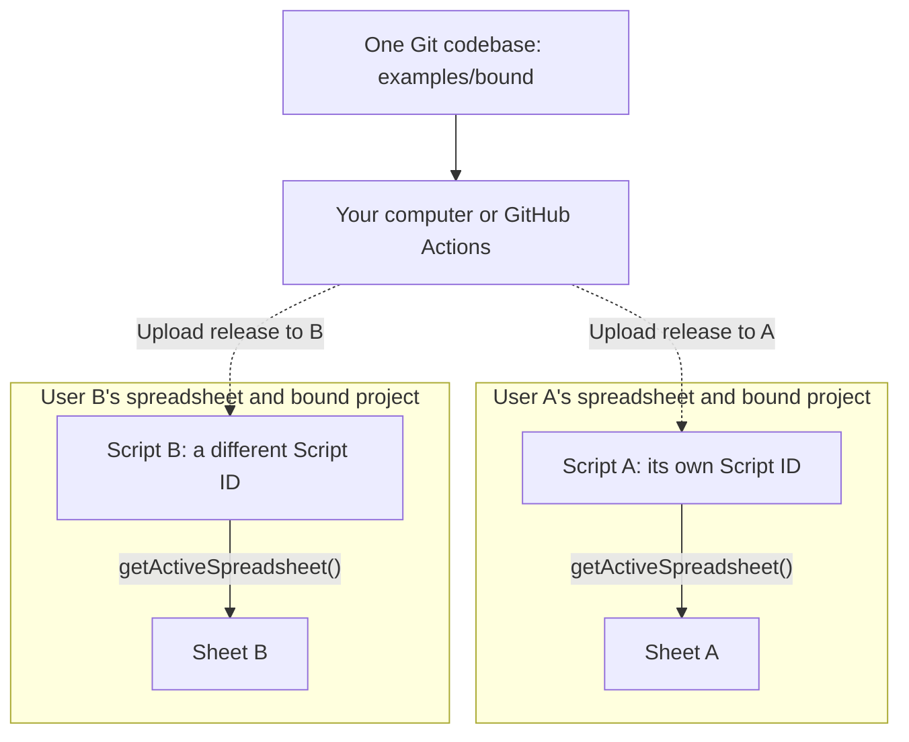
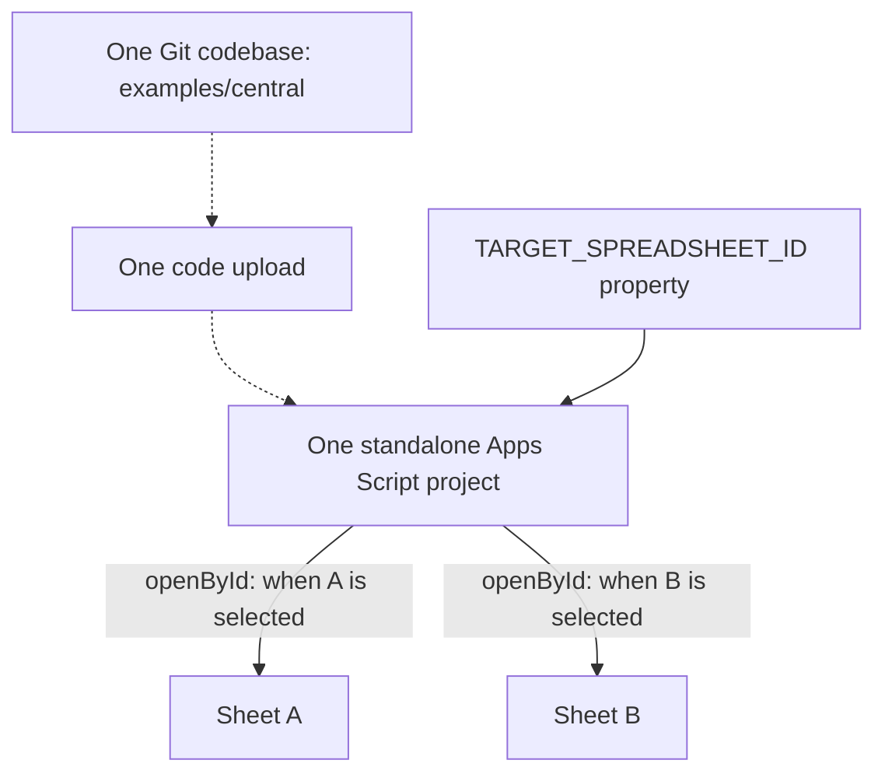
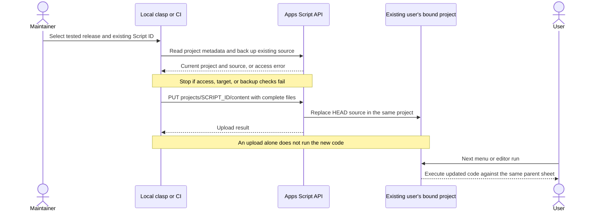
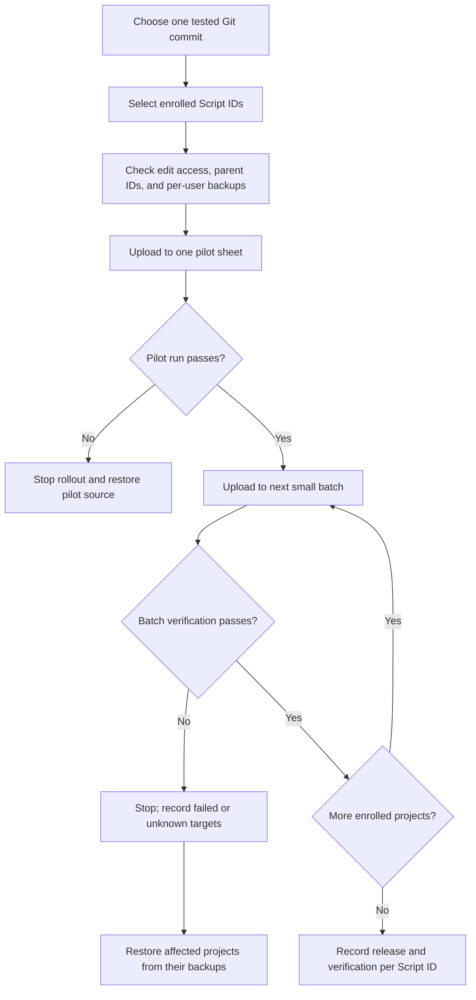

# Architecture and remote updates

Study this in order: where code runs, how an existing copy gets an update, then
how to roll out the same release to several users. The commands below are for
disposable TAK_ARCH_TEST projects. No updates run just by reading this guide.

For the missing enrollment step, see [Copy registration](copy-registration.md).
That experiment adds an activation menu and an invitation-protected registry so
copies can report their new IDs. Registration and permission to update remain
separate checks.

## 1. Bound scripts: one codebase, several running copies

You maintain the source once in Git. Each spreadsheet has its own Apps Script
project and Script ID. Upload the same source separately to every project you
want to update. The scripts execute on Google's servers.



Dashed arrows are code uploads; solid arrows inside each user group are runtime
sheet access. This is **central management of separate scripts**. It does not
require a central application to handle users' requests.

Copying a spreadsheet produces an independent bound script. Updating the template
later does not update those copies. Your updater must know the new Script ID and
have permission to edit that copy. A bound script's access follows its container;
ask the owner to grant the updater account edit access to the spreadsheet.
See Google's [bound-script guide](https://developers.google.com/apps-script/guides/bound).

## 2. Central script: one running codebase, explicit target



The lab selects **one target per run**, not both. Change its property to try
another disposable sheet. Every run uses the same script source. The executing
Google account still needs access to the selected sheet. This example is run from
the editor; it does not provide a central web app or a menu in every user's sheet.

## 3. Remote update of an existing bound script

**Upload to its existing Script ID. Do not provision a new project for an update.**
`parentId` is used at creation time. After creation, updates address the Script ID.

| You need | Why |
|---|---|
| Spreadsheet ID | Identify the user's file and check the intended parent |
| Script ID | Address the existing script project for code uploads |
| Authenticated updater with edit access | Google checks permission to change that project |
| Tested release and complete source files | The update replaces the project's source files |
| Per-project backup and release record | Recover if a release fails or a user customized code |

The update operation changes HEAD, the current editable source. This lab's menu
and editor runs use HEAD, so no versioned deployment is needed. Existing web-app
or API-executable deployments pinned to versions would require a separate
deployment update. See [project content updates](https://developers.google.com/apps-script/api/reference/rest/v1/projects/updateContent)
and [versions versus deployments](https://developers.google.com/apps-script/guides/versions).



The diagram includes recommended metadata and backup steps. `clasp push` alone
does not implement that whole procedure. API users can call `projects.get` and
`projects.getContent` before `projects.updateContent`; see [project management](https://developers.google.com/apps-script/api/how-tos/manage-projects).

### Try it with two disposable users

First create two new sheets with separate bound projects using the README setup
route. Call them A and B even if your own test account owns both. Record their
Script IDs in Project Settings. Sign in with clasp as described in the README.

Before replacing an existing project, back up its remote source in a new, empty
folder under the ignored `.local/backups/` directory: run
`npx.cmd --yes @google/clasp@3.4.1 clone-script SCRIPT_ID` from that folder, replacing
`SCRIPT_ID` with the real ID. This downloads a backup of the current remote source;
it does not update the project. Do this for each target and retain the folder. This
also captures remote edits that are absent from your Git source. Do not clone or
pull into `examples/bound`, where it could replace the release you plan to upload.

Run the following in **PowerShell 7**, replacing both placeholders. The named
configuration files are ignored by Git. They let you switch targets while keeping
one source folder and without changing the original `.clasp.json`.

```powershell
# Move to the project root and run all checks before any upload.
Set-Location 'C:\Users\martin\Documents\GitHub\TAK_ARCH_TEST'
npm.cmd run verify
# Stop immediately if syntax or tests failed.
if ($LASTEXITCODE -ne 0) { throw 'Fix the checks before uploading.' }
# Work from the source folder that will be uploaded to each bound script.
Set-Location examples/bound

# Refuse to overwrite target configurations you may already have.
if ((Test-Path .clasp.user-a.json) -or (Test-Path .clasp.user-b.json)) {
    throw 'Inspect the existing user target files before changing them.'
}
# Create separate, ignored target files so one source folder can address each user.
@{ scriptId = 'REPLACE_WITH_SCRIPT_ID_A'; rootDir = '.' } |
    ConvertTo-Json | Set-Content -Encoding utf8 .clasp.user-a.json
@{ scriptId = 'REPLACE_WITH_SCRIPT_ID_B'; rootDir = '.' } |
    ConvertTo-Json | Set-Content -Encoding utf8 .clasp.user-b.json
# Resolve absolute paths because clasp 3.4.1 can reject relative target paths.
$userAConfig = (Resolve-Path .clasp.user-a.json).Path
$userBConfig = (Resolve-Path .clasp.user-b.json).Path

# Inspect A's target ID and the local files that will be uploaded.
Get-Content .clasp.user-a.json
# Preview the local source files selected for A; it does not change A's script.
npx.cmd --yes @google/clasp@3.4.1 --project $userAConfig show-file-status
```

Confirm A's ID against the intended project's settings. The file listing should
contain only `Code.js` and `appsscript.json`; it checks local upload selection,
not remote ownership or permissions. After backing up A, upload to A:

```powershell
# Replace only user A's remote source with the checked local files.
npx.cmd --yes @google/clasp@3.4.1 --project $userAConfig push --force
# Stop the rollout if A's upload did not succeed.
if ($LASTEXITCODE -ne 0) { throw 'A upload failed. Stop and inspect before retrying.' }
```

Open sheet A and run **TAK lab > Write Hello World**. Confirm the result in its
TAK_ARCH_TEST tab. For a visible update experiment, change the greeting in
`Code.js`, rerun checks from the repo root, then push to A again. B should still
show its old behavior until you explicitly upload to B.

After A works, inspect B's target, back it up, and run from `examples/bound`:

```powershell
# Inspect B's saved target before changing anything remotely.
Get-Content .clasp.user-b.json
# Preview B's local upload set without modifying B.
npx.cmd --yes @google/clasp@3.4.1 --project $userBConfig show-file-status
# Replace only user B's remote source with the checked local files.
npx.cmd --yes @google/clasp@3.4.1 --project $userBConfig push --force
# Record the failure rather than continuing if B's upload fails.
if ($LASTEXITCODE -ne 0) { throw 'B upload failed. Record B as failed.' }
```

Run the menu in B and confirm the same greeting. Record the Git commit and outcome
for each Script ID. Keep the same PowerShell session for these commands. The
absolute configuration paths avoid a relative-path validation issue in clasp
3.4.1. The `--project` option chooses a local configuration file;
`--force` permits manifest replacement. See the [clasp command reference](https://github.com/google/clasp/blob/master/README.md).

### What users experience

- Uploading changes script source; it does not replace the spreadsheet or erase
  its cells. A subsequent run can change cells according to the new code. This
  lab overwrites only A1:C2 in its dedicated tab.
- Users do not need to paste updated code when the updater has edit access.
  Reloading the spreadsheet rebuilds the menu if `onOpen` changed.
- Added services/scopes can require users to grant additional permissions. An
  uploader's consent does not authorize every other user's execution. See
  [Apps Script authorization](https://developers.google.com/apps-script/guides/services/authorization).
- Installable triggers are separate setup, and run as their creator; uploading
  source does not create a user's triggers. A trigger needing new authorization
  can fail until its creator authorizes it interactively. This lab has no
  installable triggers. See [trigger behavior](https://developers.google.com/apps-script/guides/triggers/installable).
- Uploading replaces source files, so untracked user code can be lost. Keep
  user-specific settings in properties or sheet data, and review customizations
  before replacing source. Do not keep credentials in code files.

If the user owns a private copy and does not grant your account edit access, you
cannot silently update it. The user can grant access or perform the upload with
their own authorized account. An unknown copy is not automatically enrolled.

## 4. Updating a group: staged rollout and rollback

The current GitHub workflow updates **one configured sandbox script per run**.
The following is a proposed extension for a group of bound scripts, not an
already implemented bulk updater.



Keep an enrollment list with a friendly user label, Sheet ID, Script ID, expected
parent ID, desired release, last verified release, backup location, and outcome.
Keep real user mappings private, for example under ignored `.local/`, or in
controlled CI configuration. Keep tokens in credentials storage, separately.

A future updater should authenticate, verify each project's parent, back up its
complete remote content, and upload the same complete release to each selected
Script ID. Use small batches and bounded retries for transient failures. After a
timeout, read back content before deciding whether an upload failed. A successful
upload is different from a successful runtime check.

There is no all-users transaction: A can be updated while B fails. Record each
result and leave unchanged projects on their previous release. For GitHub Actions,
this could become a controlled target list plus a job matrix, after the single
target experiment is understood. The existing workflow does not discover users,
create backups, run users' menus, or verify every sheet.

**Rollback:** stop further uploads, select the affected Script ID, and restore its
previous complete source and manifest using the saved backup in a separate local
folder configured for that same ID. Inspect the upload list and push from there,
then verify the sheet. If remote code exactly matched a known Git release, a
separate checkout of that release is another source for restoration. Keep the
same Script ID so the sheet binding stays intact. Rolling back code does not undo
spreadsheet data changes; data migrations need their own backup/recovery plan.

## 5. Would a shared library remove the need for all these updates?

A shared Apps Script library can hold common logic while each sheet keeps a thin
bound menu/launcher. However, each consumer normally selects a library version.
Publishing a new library version does not advance every consumer's pinned
version. Updating the version reference still requires updating those consumers.
Development mode uses current library code for testing with appropriate access;
it is not a substitute for a controlled user rollout. See [Google's library guide](https://developers.google.com/apps-script/guides/libraries).

For this lab, compare bound copies and the standalone central example first.
Libraries or thin launchers calling a central service are later experiments with
their own permission, versioning, and runtime design choices.
