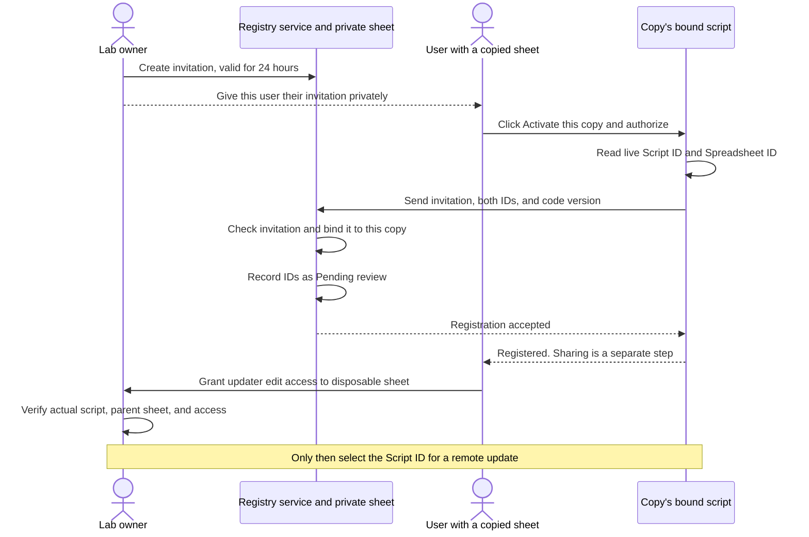

# Experiment C: find copied scripts through registration

When someone copies your spreadsheet, you do not automatically receive the new
Script ID. This experiment puts **TAK lab > Activate this copy** into the
template. When a user clicks it and authorizes the script, the copy reports its
own IDs to your registry. The registry records the copy for owner review.

This is implemented as two small Apps Script projects with no npm dependencies:

| Project | Source folder | Purpose |
|---|---|---|
| User template | `examples/registration-client` | Bound menu, greeting, and registration request |
| Owner registry | `examples/registration-registry` | Private registry sheet, invitations, and web app receiver |

The earlier `examples/bound` and `examples/central` stay unchanged. The registry
receives enrollment data; users' application code still runs in separate bound
scripts. It is not a central application runtime.

## What happens



The copied code uses `ScriptApp.getScriptId()` and
`SpreadsheetApp.getActiveSpreadsheet().getId()` each time. It does not reuse a
template ID or trust a copied "already activated" flag. See
[ScriptApp.getScriptId](https://developers.google.com/apps-script/reference/script/script-app#getScriptId()).

## 1. Prepare the owner's private registry

Use disposable Google data and sign in with clasp as described in the README.

1. Create a blank Google Sheet named **TAK_ARCH_TEST Registry**. Keep it private
   to the owner (and any trusted administrators); users do not need access to it.
2. Open **Extensions > Apps Script**, name the project **TAK_ARCH_TEST Registry**,
   and copy its Script ID from Project Settings.
3. From PowerShell in the repo root, replace the placeholder and run:

```powershell
npm.cmd run setup -- registration-registry YOUR_NEW_REGISTRY_SCRIPT_ID
Push-Location examples/registration-registry
try {
    npx.cmd --yes @google/clasp@3.4.1 show-file-status
    npx.cmd --yes @google/clasp@3.4.1 push --force
} finally { Pop-Location }
```

4. In the registry script editor, run `initializeRegistry` and authorize it.
   This creates the **Registrations** tab and saves `REGISTRY_SPREADSHEET_ID` in
   that project's Script Properties. It refuses an existing tab with different
   headers, so unrelated data is not overwritten.
5. Reload the spreadsheet to see the **TAK registry** menu.
6. In the script editor choose **Deploy > New deployment > Web app**. Select
   **Execute as: Me** (the registry owner), and **Who has access: Anyone** (the
   setting that allows requests without Google sign-in). Deploy and copy the URL
   ending in `/exec`, not `/dev`.

This intentionally makes the receiver URL internet-accessible. Its code accepts
enrollment only with an invitation; the registry spreadsheet stays private. The
receiver writes using its owner's authority. There is no endpoint for reading the
registry, sharing a file, or uploading script code. A URL by itself is not a
credential. Google Workspace policy may prevent this deployment option; if so,
use a permitted test environment or collect IDs manually for this experiment.
An authenticated Google login page cannot be used by this simple UrlFetch client.
See [web app permissions](https://developers.google.com/apps-script/guides/web).

The registry requests spreadsheet access because the web app opens its configured
sheet by ID. It does not use active-sheet context in a web request. Restrict the
account to lab data while experimenting.

## 2. Prepare the copyable user template

1. Create a second blank Sheet named **TAK_ARCH_TEST Registration template** and
   open **Extensions > Apps Script** to create its bound project.
2. In local `examples/registration-client/Code.js`, replace the
   `REGISTRY_URL` placeholder with the registry `/exec` URL. This URL can be
   included in copied code; never put invitation codes or Google tokens there.
3. Copy the template's Script ID and upload:

```powershell
npm.cmd run setup -- registration-client YOUR_NEW_TEMPLATE_SCRIPT_ID
Push-Location examples/registration-client
try {
    npx.cmd --yes @google/clasp@3.4.1 show-file-status
    npx.cmd --yes @google/clasp@3.4.1 push --force
} finally { Pop-Location }
```

4. Reload the template. Its **TAK lab** menu contains **Activate this copy** and
   **Write Hello World**. Opening it only adds the menu; it sends no data.
5. Make two copies of the template, named **Registration copy A** and
   **Registration copy B**. You can own both for the first experiment.

Users authorize current-spreadsheet access and outgoing requests when needed.
Registration runs from a menu click because a simple `onOpen` trigger cannot use
services requiring authorization. See [trigger restrictions](https://developers.google.com/apps-script/guides/triggers#restrictions)
and [UrlFetch authorization](https://developers.google.com/apps-script/reference/url-fetch/url-fetch-app).

## 3. Issue invitations and activate the copies

In the owner's registry sheet, choose **TAK registry > Create invitation**. A
dialog displays a code valid for 24 hours. Give it privately to one test user for
one copy. Do not commit it or post it in this repository. The registry stores its
hash and expiry in Script Properties, not the raw code. The client does not save
the code after making its request.

In copy A, click **TAK lab > Activate this copy**, authorize if prompted, then
enter the invitation. If the Google consent flow interrupted the menu action,
click the menu again afterward. The prompt explains exactly what will be sent:

- Current copy's Script ID.
- Current copy's Spreadsheet ID.
- Reported code version (`LAB_VERSION`, initially `0.1.0`).

No email, sheet title, cell contents, or Google access token is sent. The invitation
is sent in the HTTPS request body, not in its URL. The client follows the redirect
used for Apps Script JSON responses. See [Content Service redirects](https://developers.google.com/apps-script/guides/content#redirects).

Look in the private **Registrations** tab: A should appear as **Pending review**.
Generate a second invitation for B and activate B. Its two IDs should be different
from A's. Confirm each Script ID manually in that copy's Apps Script settings and
each Spreadsheet ID in its URL.

Try these checks:

1. Repeat A's activation with A's unexpired invitation: no duplicate row appears.
2. Try A's invitation in B: it is rejected, because it is bound to A's IDs.
3. Cancel the activation prompt: nothing is sent.
4. Choose **Revoke all invitations** in the registry, confirm, then retry an old
   code: it is rejected. Existing registry rows remain.
5. Make another copy but do not activate it: it does not appear in the registry.

If a request or response fails, retry the same invitation with the same copy
before it expires. The server locks registration writes and binds the invitation
before adding the row, allowing recovery from a failed write. Expired codes need
a new invitation. Repeated activation does not change the owner's review status
or refresh the stored version; this is an enrollment registry, not a heartbeat or
installed-version tracker.

## 4. Registration is not permission to update

The invitation admits a submission. It does **not** prove the caller's identity,
ownership of the reported IDs, or permission for you to edit that script. Treat
all entries as claims until checked. The receiver does not mark any row approved
and the current deployment workflow does not consume registry rows.

Before a real update:

1. The user grants your updater account **Editor** access to their disposable
   spreadsheet. Do not share the registry sheet with users.
2. With the updater account, inspect the shared sheet and its **Extensions >
   Apps Script** project. Match both real IDs to the registration. An automated
   implementation would use `projects.get` and verify the returned `parentId`.
3. After confirming the target and access, record **Approved manually** in the
   review column. This is your note; it does not change Google permissions.
4. Back up that project's source and follow the
   [remote update procedure](architecture-and-updates.md#3-remote-update-of-an-existing-bound-script).
   For this experiment upload from **examples/registration-client**, so you keep
   the activation menu. Use the copied project's Script ID, not the template's.

Bound-script access follows the spreadsheet's access list. Knowing a Script ID or
holding an invitation does not bypass it. See [bound script access](https://developers.google.com/apps-script/guides/bound#access_to_bound_scripts).

## 5. Updating or stopping this experiment

The existing GitHub manual upload workflow is only for `bound` and `central`.
Use the documented local clasp commands for these two new projects. `npm run
setup` supports their names; `npm run provision` intentionally remains limited to
the original A/B examples. No Google projects or public endpoints were created
as part of adding this code to the repository.

After changing registry code, upload it **and edit the existing web app deployment
to use a new version**. Keep the existing deployment URL so templates still reach
it. A clasp source upload alone does not update a versioned web app deployment.
See [versions and deployments](https://developers.google.com/apps-script/guides/versions).

To stop enrollment, revoke invitations and archive the registry's web app
deployment in Manage deployments. Remove copied test files when no longer needed.
Do not distribute the registry spreadsheet as a user template.

## Local verification and limits

Run `npm.cmd run verify`. Tests cover live ID capture, two independent copies,
invitation expiry/reuse/revocation, cancellation, duplicate prevention, malformed
requests, conflicting IDs, interrupted writes, and preservation of owner review.
They use fake Google services; actual consent, permissions, public deployment,
Workspace policy, and end-to-end copying still need a Google-account test.

This is a small invitation-based lab. The receiver is reachable publicly and is
subject to Apps Script quotas even for rejected requests. It has no authenticated
user enrollment, durable audit trail, or production rate limiting. Before using
it beyond a controlled experiment, add verified enrollment and operational
controls. Never automatically deploy to a Script ID just because it was submitted.
