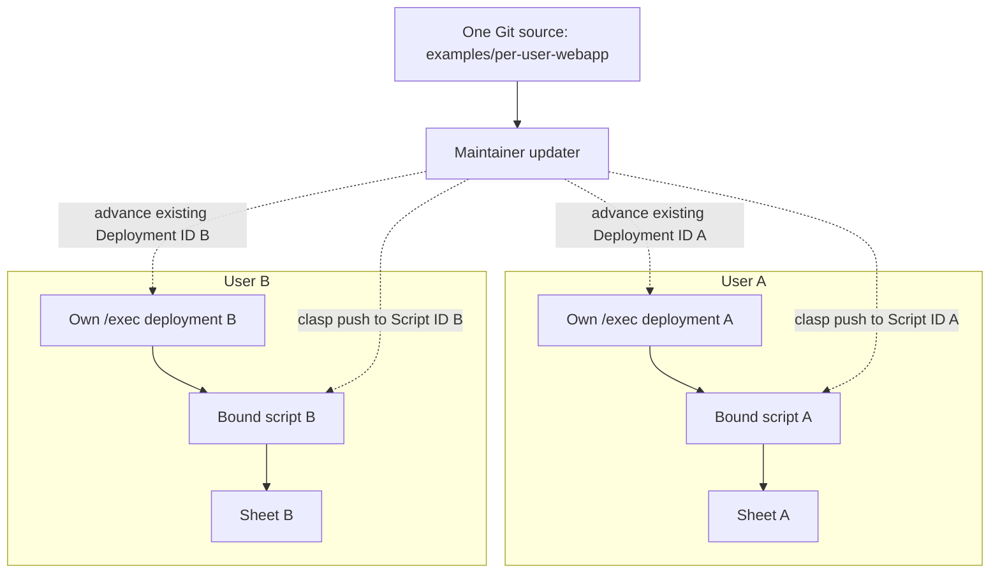

# Experiment D — one copied Sheet, one bound script, one /exec web app per user

The intended TAK architecture is **not** a central web app. Every user has
a distinct spreadsheet, a distinct container-bound Apps Script project, and
a distinct **versioned /exec deployment**. Your Git repository is the single
source of code, but each user's code is uploaded separately.



## Three IDs you must not confuse

| ID | Purpose |
|---|---|
| **Spreadsheet ID** | The user's own data file; stored in *that copy's* Script Properties on initialization |
| **Script ID** | The user's bound code project; `clasp push` updates its **HEAD** |
| **Deployment ID** | The user's existing published web app; updating it to a new version preserves its **/exec URL** |

**HEAD** and **/dev** use the most recently saved code. **/exec** runs a
published, immutable code *version*. A `clasp push` does **not** update /exec;
create a new version and update the *existing* deployment ID afterward.

## Install the template (lab account, disposable Sheet)

1. Create a new Google Sheet and open **Extensions > Apps Script**.
2. Copy the new project's **Script ID** from Project Settings.
3. Enable the Apps Script API and authenticate clasp (see the main README).
4. In PowerShell from the repository root:

```powershell
npm.cmd run setup -- per-user-webapp YOUR_TEMPLATE_SCRIPT_ID
Push-Location examples/per-user-webapp
try {
  npx.cmd --yes @google/clasp@3.4.1 show-file-status
  npx.cmd --yes @google/clasp@3.4.1 push --force
} finally { Pop-Location }
```

5. Refresh the Sheet and click **TAK lab > Initialize this copy**.
6. The template may have its own test deployment, but copied users **must
   never reuse the template's /exec URL**.

## Each new user creates their own /exec app

1. Choose **File > Make a copy** of the template. This creates a new
   spreadsheet **and** an independent bound Apps Script with a new Script ID.
2. From the copied Sheet, click **TAK lab > Initialize this copy**. The
   handler records the copy's live Spreadsheet ID in its own Script Properties.
   It deliberately overwrites a stale copied template ID.
3. In **Extensions > Apps Script > Deploy > New deployment > Web app**, choose
   **Execute as: Me** and **Who has access: Only myself** for this private
   experiment. Authorize the requested scopes, then **Deploy**.
4. Save the user's **Script ID, Spreadsheet ID and Deployment ID** in a private,
   verified release registry. User A and B have different IDs and /exec URLs.
5. Open that user's /exec URL. It should show their own Sheet name and lab
   version. The Sheets menu **Open my TAK web app** is a convenience launcher.

The example's `doGet()` uses `SpreadsheetApp.openById()`: a web request does
**not** have the same active-sheet context as a Sheet menu event. The copy
stores its live Sheet ID during initialization; the versioned web app reads it
from that *project's* Script Properties.

**Permissions and privacy:** Updating somebody else's bound script requires
Google authorization. In this lab the user grants the maintainer Editor
access to their Sheet; that also grants access to their data. Knowing IDs or
registering a copy is **not** permission to edit it. Existing web-app
deployments retain their deployer's identity, which can affect whether an
editor is authorized to update them; test with two actual accounts before
promising an unattended update service.

## Update one user from 0.1.0 to 0.2.0

1. Edit `TAK_LAB_RELEASE` in `examples/per-user-webapp/Code.js`.
2. Run `npm.cmd run verify`. Inspect and **back up** the user's existing
   remote source. Confirm their live Script ID, parent Spreadsheet ID,
   deployment ID and updater access.
3. Upload the same source to the **existing** user Script ID (not a new one):

```powershell
Push-Location examples/per-user-webapp
try {
  @{ scriptId = 'USER_A_SCRIPT_ID'; rootDir = '.' } |
    ConvertTo-Json | Set-Content -Encoding utf8 .clasp.user-a.json
  $config = (Resolve-Path .clasp.user-a.json).Path
  npx.cmd --yes @google/clasp@3.4.1 --project $config show-file-status
  npx.cmd --yes @google/clasp@3.4.1 --project $config push --force
} finally { Pop-Location }
```

**At this point A's HEAD and /dev have 0.2.0, but A's /exec still has 0.1.0.**

4. Run a **dry run**, which makes no Google calls:

```powershell
npm.cmd run release-webapp -- USER_A_SCRIPT_ID USER_A_SHEET_ID USER_A_DEPLOYMENT_ID
```

5. After confirming all IDs, use a short-lived OAuth access token for the
   updater Google account with
   `https://www.googleapis.com/auth/script.projects` and
   `https://www.googleapis.com/auth/script.deployments`.
   Enable the Apps Script API for that OAuth client. In PowerShell 7:

```powershell
$env:GOOGLE_ACCESS_TOKEN = Read-Host 'OAuth access token' -MaskInput
try {
  npm.cmd run release-webapp -- USER_A_SCRIPT_ID USER_A_SHEET_ID USER_A_DEPLOYMENT_ID --apply
} finally {
  Remove-Item Env:GOOGLE_ACCESS_TOKEN -ErrorAction SilentlyContinue
}
```

This calls `projects.get` to verify the parent, `deployments.get` to
verify an existing web-app /exec, `versions.create` to snapshot HEAD,
then `deployments.update` to point the **same Deployment ID and URL** at
the new version. No new deployment is created. Repeat for B separately.

If the deployment update fails, inspect the remote state before retrying.
A version may have been created even if promotion failed. Do not assume
updates to spreadsheet *data* can be rolled back by reverting source code.

## What this experiment deliberately does *not* do

- It does not create a user's deployment or obtain user consent automatically.
- It does not discover users, create source backups, or run a fleet rollout.
- The one-target promoter does **not** upload HEAD; `clasp push` is separate.
- Tests are mocked: actual Google ownership/consent, cross-account deployment
  updates, and runtime behavior still require manual end-to-end verification.
- Production deployment ownership and privacy need a separate design review.

## Official documentation

- [Web apps](https://developers.google.com/apps-script/guides/web)
- [Versions and deployments](https://developers.google.com/apps-script/concepts/deployments)
- [Create versions](https://developers.google.com/apps-script/api/reference/rest/v1/projects.versions/create)
- [Update deployments](https://developers.google.com/apps-script/api/reference/rest/v1/projects.deployments/update)
